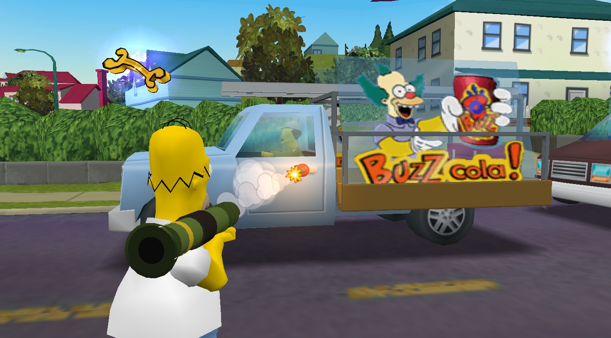
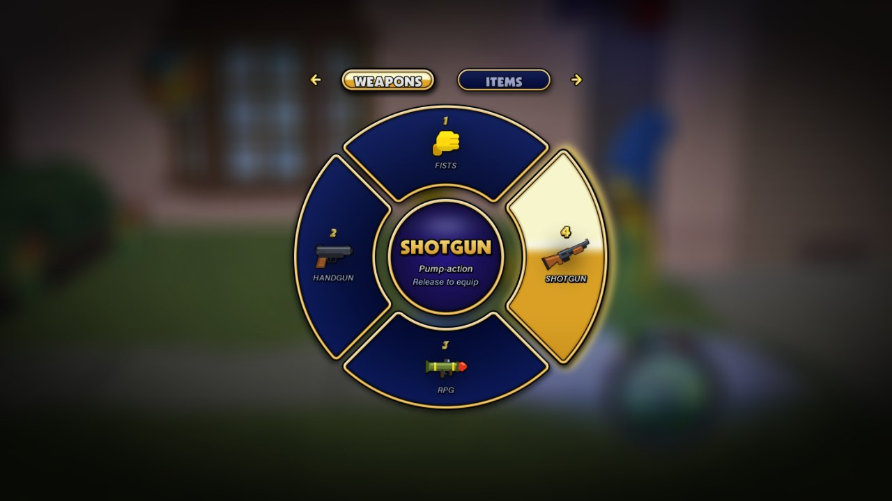
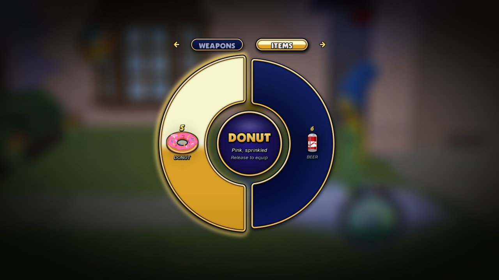
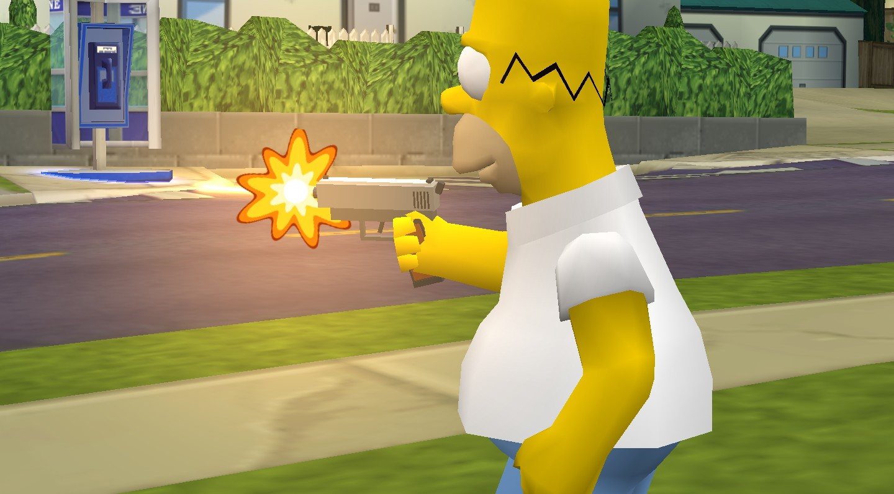
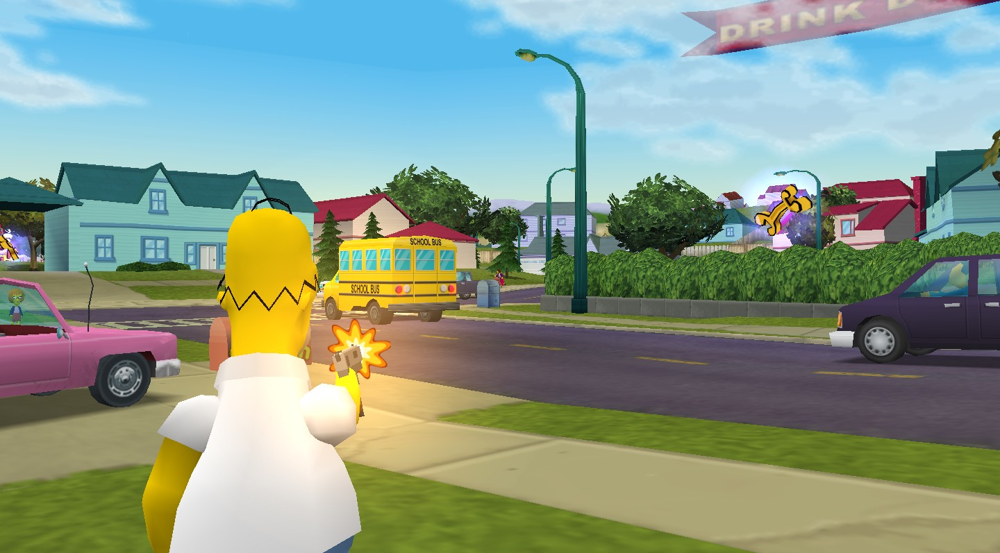
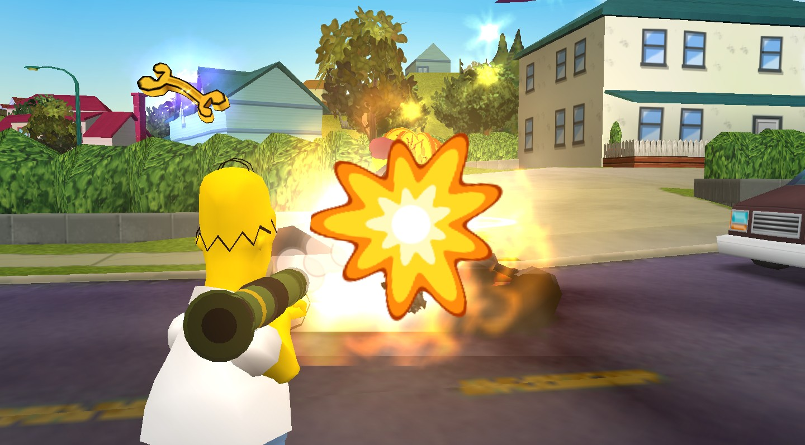
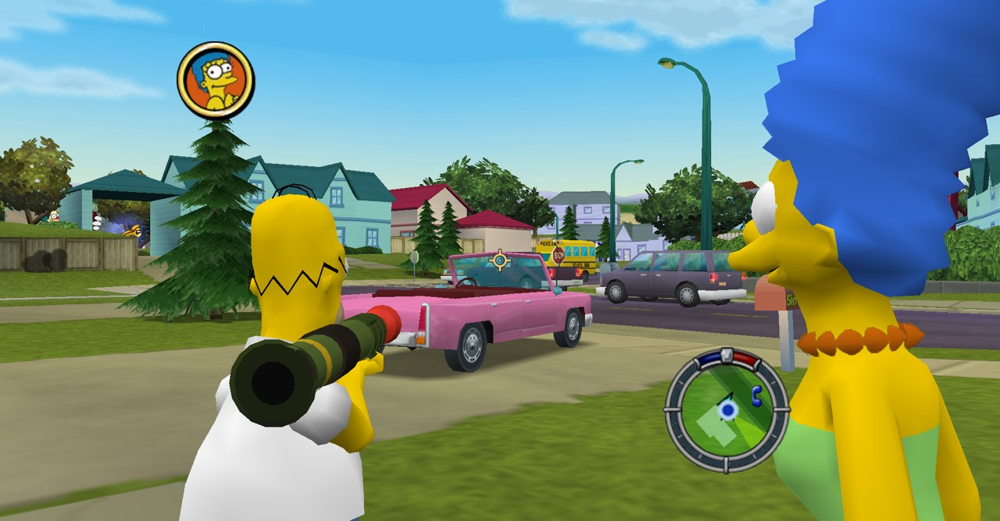
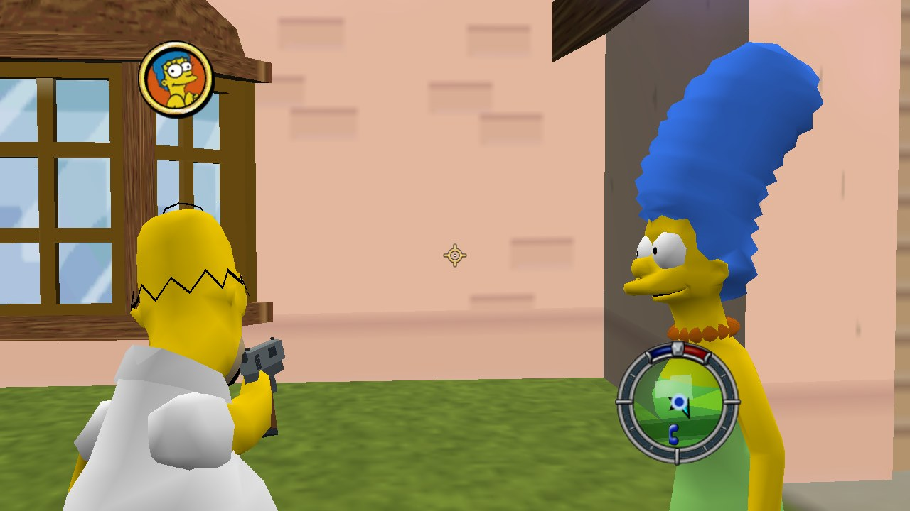
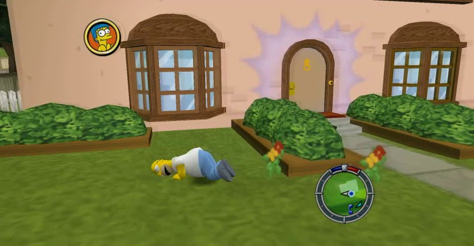

# Hit & Run: Unleashed

**An unofficial, fan-made gameplay expansion for *The Simpsons: Hit & Run* (PC, 2003): a weapon wheel, three weapons
and two items, designed to complement the original game's style.**

Hold a button, the game slows down behind a gold-and-navy wheel, and you pick a **handgun**, a **pump-action shotgun**, a
**rocket launcher**, a **donut** or a **beer**. It's a drop-in `d3d8.dll`: no game files are changed, and none are included.

[**⬇ Download the latest release**](../../releases/latest)



| | |
|---|---|
|  |  |
|  |  |
|  |  |
|  |  |

---

## Contents

- [Design Philosophy](#design-philosophy)
- [Features](#features)
- [Requirements](#requirements)
- [Install](#install)
- [Lucas' Mod Launcher settings](#lucas-mod-launcher-settings)
- [Controls](#controls)
- [Settings](#settings-weaponwheelini)
- [Known limitations](#known-limitations)
- [Troubleshooting](#troubleshooting)
- [Uninstall](#uninstall)
- [Building from source](#building-from-source)
- [Credits and legal](#credits-and-legal)

## Design Philosophy

Hit & Run: Unleashed is an unofficial, fan-made gameplay expansion for The Simpsons: Hit & Run (2003).

New weapons, items, animations, and effects have been designed to complement the original game's visual style, character
proportions, and gameplay conventions, creating a cohesive experience within Springfield.

This project is independently developed and is not affiliated with, endorsed by, or sponsored by Radical Entertainment,
Disney, or the original game's rights holders.

## Features

**The wheel**
- Hold **LB** (or **Tab**) on foot. The game slows to 30 % and blurs behind the wheel, with the game's own menu sounds.
- Two pages: **Weapons** (1 fists, 2 handgun, 3 RPG, 4 shotgun) and **Items** (5 donut, 6 beer). **RB** (or **Q**) flips
  between them. Let go to equip.
- Drawn in the game's style. The title font, gold digits and arrows are the game's own, read from your copy when the game starts.

**Handgun**
- Aim over the shoulder in every direction. Your character turns, twists, looks at the target and raises the gun.
- Muzzle flash, smoke, a tracer, a bouncing shell casing, recoil, camera kick and rumble.
- Shots hit what's under the crosshair, traced through the game's own collision, and the world reacts the game's way:
  - bullet holes
  - pedestrians knocked down
  - cars that smoke and finally blow up
  - glass that cracks, then shatters on the third hit
  - tires that pop and go flat
  - hydrants, signs and phone booths that break
  - wasp cameras that explode
  - a Hit & Run meter that rises
- Tap fire without aiming for a quick shot from the hip.

**Pump-action shotgun**
- Pulled from the pocket, taken in both hands and racked.
- Ten pellets a shot, a big kick, and people knocked flying. He pumps it after every shot.

**Rocket launcher (RPG)**
- Rides on the character's right shoulder, sized to fit everyone from Bart to Homer.
- Fires a real rocket that flies through the world and explodes like a car blowing up.
- A car it hits is wrecked. Anything else nearby gets damaged, shoved or knocked flying, and walls shield what's behind them.
- Blow up enough traffic and the police come after you. Mission-protected cars stay protected, and your own rockets
  don't hurt you.
- The next rocket loads in about 1.6 s.

**Donut and beer**
- Every pick is another one. The donut comes out of a pocket and is eaten in four bites, with crumbs and a belly pat.
  It's just for fun and has no effect on play.
- The beer adds up: a few cans and your character sways, waddles, stumbles, trips and falls (and gets back up). Driving
  gets wobbly, there's double vision, and it all wears off over time.
- Homer, Marge and Apu drink. Bart and Lisa don't get the beer: its slot is dimmed for them.

**Everywhere**
- Controller and keyboard + mouse side by side. Switch any time.
- Shooting from cars is planned for a later release.
- Weapons are put away by themselves in cars and cutscenes, and come back out after.
- Every button, key and option can be changed in `WeaponWheel.ini`.

## Requirements

- ***The Simpsons: Hit & Run* for PC, English release.** Everything was found and tested on the English release. On other
  releases (International, Best Seller Series, the demo) the wheel and weapons appear, but shots and rockets don't hit
  anything: the mod detects the version and switches the game-specific parts off rather than risk a crash.
- **Windows 10 or 11.** Tested on Windows 11. On Windows 7 only keyboard and mouse work, because the controller support
  needs Windows 8 or later. Linux, Steam Deck and Mac (Wine, Proton, CrossOver) need a DLL override, see
  [Troubleshooting](#troubleshooting).
- **Optional: [Lucas' Simpsons Hit & Run Mod Launcher](https://modbakery.donutteam.com/projects/view/6)**, needed for
  controller support (its **XInput** hack). Keyboard and mouse work without it.

## Install

1. Download `Unleashed-v1.0.0.zip` from the [latest release](../../releases/latest).
2. Open your game folder, the one with `Simpsons.exe` in it.
3. Extract the ZIP **straight into that folder**. You should end up with:
   ```
   <game folder>\Simpsons.exe        (the game's own)
   <game folder>\d3d8.dll            (the mod)
   <game folder>\WeaponWheel\        (the mod's art, sounds, settings and readme)
   ```
4. Start the game as usual, through the Mod Launcher or `Simpsons.exe`.

Hold **LB** or **Tab** on foot to open the wheel. If nothing happens, see [Troubleshooting](#troubleshooting).

## Lucas' Mod Launcher settings

| Launcher hack | Setting | Why |
|---|---|---|
| **XInput** | **On** for a controller | The mod reads the controller through XInput. Without it, keyboard and mouse only. |
| **Direct3D 9** | **Must be off** | With it on, the game never loads `d3d8.dll`, so the mod can't start. A message box tells you if it's on. |
| Other hacks | Your choice | Tested release setup: launcher 1.26.1 with only XInput on, windowed. The dev tests also used SkipMainMenu, NoIntroductionMovies and NoPauseOnDefocus. |

Anything else that is itself a `d3d8.dll` (dgVoodoo, d3d8to9, ReShade for Direct3D 8) can't run alongside this mod: there
can only be one `d3d8.dll` in the game folder.

## Controls

On foot, with the game's own controls unchanged otherwise:

| Action | Controller | Keyboard + mouse |
|---|---|---|
| Open the wheel (hold), equip (release) | **LB** | **Tab** + move the mouse toward a slot |
| Highlight a slot | Either stick, or step with D-pad left / right | Mouse, or the scroll wheel |
| Flip Weapons / Items page | **RB** (fixed) | **Q** (while the wheel is open) |
| Pick directly | — | **1** fists · **2** handgun · **3** RPG · **4** shotgun · **5** donut · **6** beer |
| Next / previous weapon | — | Scroll wheel (one step per flick) |
| Back to the last weapon | — | **Q** |
| Aim | Hold **LT** (or D-pad left), right stick aims | Hold **right mouse**. A quick click toggles aim (for trackpads). |
| Fire | **RT** (without aiming: a hip shot) | **Left mouse** |
| Eat the donut, drink the beer | Picking it starts eating or drinking | same |
| Reload / pump | Automatic | Automatic |
| Put the weapon away | Pick **Fists** | **1** |
| Get in/out of cars, talk, doors | Game default | **E** (the mouse buttons belong to the weapon) |
| Kick | Game default | **F** (handbrake in a car) |

Letters and digits are key *positions*, like the game's own keys: on a French AZERTY keyboard, `Q` is the key marked A.

## Settings (`WeaponWheel.ini`)

Open `WeaponWheel\WeaponWheel.ini` in Notepad, save, and restart the game.

| Key | Default | What it does |
|---|---|---|
| `Enabled` | `1` | `0` turns the whole mod off |
| `SlowMotion` | `0.3` | Game speed while the wheel is open (`1` = normal) |
| `Blur` | `1` | Background blur: `0` off, `1` normal, `2` strong |
| `Brightness` | `0.72` | Background brightness while the wheel is open |
| `Size` | `1.0` | Wheel size |
| `Volume` | `0.6` | Loudness of the mod's own sounds |
| `WheelButton` / `AimButton` / `FireButton` | `LB` / `DPAD_LEFT LT` / `RT` | Controller buttons |
| `AimSensitivity` | `1.0` | Right-stick aiming speed |
| `InvertY` | `0` | `1` = push up to look down |
| `AimDeadzone` | `0.20` | Raise it if the aim drifts by itself |
| `Keyboard` | `1` | `0` = controller only |
| `MouseSensitivity` | `1.0` | Mouse aiming speed (`1` = 0.022° per count) |
| `MouseInvertY` | `0` | `1` = mouse up looks down |
| `WheelMouseDistance` | `100` | How far the mouse moves to pick a slot (raise it if it feels jumpy) |
| `AimClick` | `1` | A quick click of the aim key keeps aiming until the next click. `0` = hold only |
| `KeyWheel` / `KeyAim` / `KeyFire` | `TAB` / `MOUSE2` / `MOUSE1` | Wheel, aim, fire |
| `KeyFists` / `KeyHandgun` / `KeyRPG` / `KeyShotgun` | `1` / `2` / `3` / `4` | Pick a weapon |
| `KeyDonut` / `KeyBeer` | `5` / `6` | Pick an item (not in the ini; add them to change) |
| `KeyLastWeapon` / `KeySwitchPage` | `Q` / `Q` | Last weapon; flip the wheel's page |
| `KeyAction` / `KeyKick` | `E` / `F` | The game's left / right click (cars, talk, kick) |
| `Debug` | `0` | Developer test commands. **Leave at 0.** With `1`, the mod takes commands from a text file in its folder and writes a 16 MB image dump. |

**Button names:** `A B X Y LB RB LT RT LS RS BACK START DPAD_UP DPAD_DOWN DPAD_LEFT DPAD_RIGHT`. Put spaces between names to
give one job several buttons. `WheelButton` must be a button, not a trigger. The wheel's RB page flip and D-pad
stepping are fixed.

**Key names:** `A`–`Z`, `0`–`9`, `F1`–`F12`, `TAB SPACE SHIFT CTRL ALT CAPSLOCK ENTER BACKSPACE GRAVE UP DOWN LEFT RIGHT`,
`MOUSE1`–`MOUSE5`. Up to two keys per job. `NONE` turns a job off, and an empty value means the default.

## Known limitations

None of these was judged a release blocker:

- **Long hip-fired rockets** can pass through a wall that the game draws but has no collision for, when that wall is
  off-screen along the rocket's path. Aim first (LT / right mouse) for reliable hits.
- **The very edge of a wall:** rarely, a rocket aimed exactly at the edge of a building can fly past it.
- **Tight spaces:** indoors or pressed against a car, the over-the-shoulder camera has no room and can clip into your
  character.
- **Point-blank rockets** knock you down, so firing repeatedly into a wall right in front of you keeps you on the ground.
- **High explosions** on walls show fire and smoke, without the game's ground ring and debris (intended).
- **Small animation details:** for a frame, an arm can pass slightly into the body when a drink is put away mid-sip, or
  swing quickly as an item is first picked. Marge's can rides up under her lip as she drains it.
- **Other game releases** (non-English, Best Seller Series, demo): the wheel works, but shots and rockets don't hit
  anything.
- **Not tested:** fullscreen mode (tested windowed, 800×600 to 1920×1080 and ultrawide), Lisa with the donut and beer, and
  full playthroughs of every mission.

## Troubleshooting

`WeaponWheel\WeaponWheel.log` says what the mod saw: game version, controller, keys, sounds and art. Its first line reads
`SHAR Weapon Wheel 1.0.0 loaded`, the mod's internal name. It is rewritten every
time the game starts, so copy it before restarting if you want to attach it to a bug report.

| Problem | Fix |
|---|---|
| Nothing happens, no `WeaponWheel.log` | `d3d8.dll` isn't next to `Simpsons.exe`, or your antivirus removed it (see below). The game's exe must be named `Simpsons.exe`. |
| A message says the Direct3D 9 hack is on | Turn the Mod Launcher's **Direct3D 9** hack off and restart. |
| The controller doesn't open the wheel | Turn the Mod Launcher's **XInput** hack on. |
| A key does nothing | The log's `Keys:` lines list every key in use and anything in the ini it didn't understand. |
| Text or sounds are missing | The mod reads them from the game's `art\frontend` folder and `soundfx.rcf`. See the log's `Game art` and `Sounds` lines. |
| Shots and rockets don't hit anything | You're on a non-English release. See [Requirements](#requirements). |
| Homer doesn't fall over when drunk | The log says `dbody: no skin points`: the mod couldn't read `art\chars\homer_m.p3d` or `homer_a.p3d` from your game, so Homer gets the simpler drunk sway the other characters have. |
| A character's chin sits in the shotgun's stock | The log's `chin points` line names a model it couldn't read from `art\chars` (or one replaced by a different model). |
| Antivirus flags or deletes `d3d8.dll` | It's a false positive: the DLL hooks into the game the way overlays and trainers do. Restore it from your antivirus's protection history, or build it yourself from this source. |
| Game installed under `C:\Program Files` | Windows may keep the log in `%LOCALAPPDATA%\VirtualStore`, and Notepad may need "Run as administrator" to save the ini. |
| Linux, Steam Deck, Mac (Wine, Proton, CrossOver) | Set a DLL override `d3d8` = "native, builtin": in `winecfg` > Libraries, or the Steam launch option `WINEDLLOVERRIDES="d3d8=n,b" %command%`. |
| Another `d3d8.dll` mod is installed | Only one can be in the folder. Remove the other one. |

## Uninstall

Close the game, then delete these from the game folder:

- `d3d8.dll`
- the `WeaponWheel` folder

That's everything. The mod doesn't change any other files.

## Building from source

Windows, 32-bit DLL, built with the portable [llvm-mingw](https://github.com/mstorsjo/llvm-mingw) toolchain, release
20260922 (`llvm-mingw-20260922-msvcrt-x86_64`): unpack it into `tools/`, so that
`tools/llvm-mingw-20260922-msvcrt-x86_64/bin` exists. Then, in Git Bash or any `sh`:

```sh
sh build.sh                      # -> build/d3d8.dll: the release's DLL, byte for byte apart from its build timestamp
```

The package's art and sounds are in `dist/WeaponWheel/`. To make them again:

```sh
SHAR_GAME="C:/path/to/the/game" python assets/build_assets.py assets/out/full   # the atlas, with the game's own art in place
python assets/strip_game_art.py assets/out/full assets/out                      # ...and that art blanked again, as shipped
python assets/build_sounds.py assets/out                                         # the sounds (synthesized)
```

The atlas comes out byte for byte as shipped, and so do 21 of the 22 sounds. `sfx_shell.wav` was made by an earlier
version of `build_sounds.py`: a later change to another sound shifted the random numbers it's made from.

How it works: [docs/HOW_IT_WORKS.md](docs/HOW_IT_WORKS.md).

## Credits and legal

- Game memory addresses from **[SHARMemory](https://github.com/Hampo/SHARMemory)** by Lucas Cardellini and Hampo.
- **[Lucas' Simpsons Hit & Run Mod Launcher](https://modbakery.donutteam.com/projects/view/6)** by Lucas Cardellini. Its XInput
  hack is what makes the controller work.
- Built with **[llvm-mingw](https://github.com/mstorsjo/llvm-mingw)** by Martin Storsjö.

*The Simpsons: Hit & Run* © 2003 Radical Entertainment, Vivendi Universal Games and Twentieth Century Fox. *The Simpsons*
is a trademark of Twentieth Century Fox Film Corporation. This is an unofficial fan-made mod, not affiliated with or
endorsed by any of them. **No game files are included.** The mod reads the art and sounds it borrows from your own copy
of the game, and you need your own copy of the game to use it. Homer's skin points for the drunk falls, and each
character's chin points for the shotgun, are built from your copy of the game when it starts. The DLL does contain a
small amount of numeric data measured from the game's character models and animations: body proportions, eye
positions, torso profiles, joint ranges and hand placements, used to fit the weapons and items to the characters.

The mod's own code, art and sounds are released under the [MIT License](LICENSE). That license doesn't cover the game or
anything derived from it. The DLL statically includes the MinGW-w64 runtime; its notices are in
[THIRD-PARTY-NOTICES.txt](THIRD-PARTY-NOTICES.txt).
